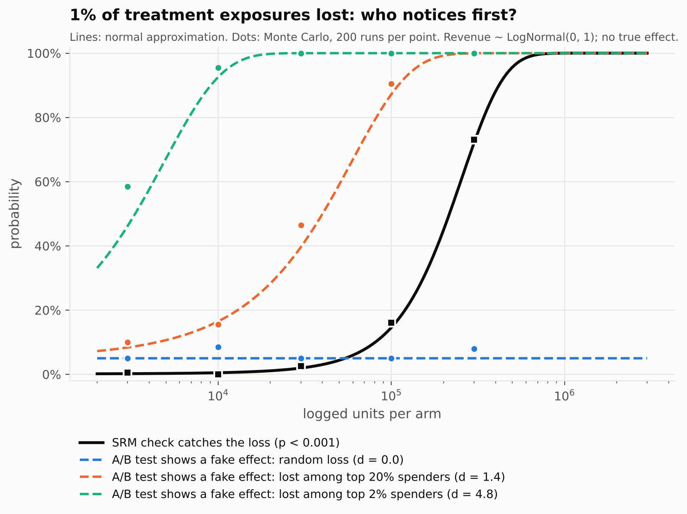
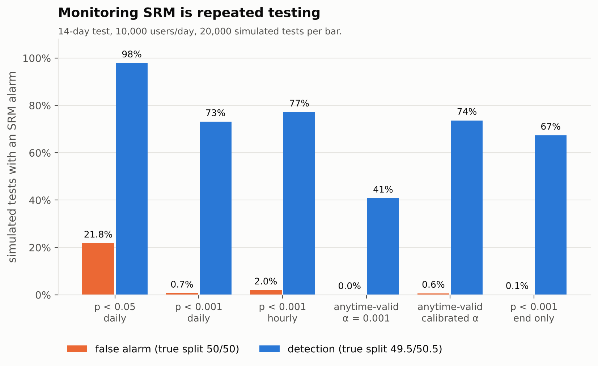
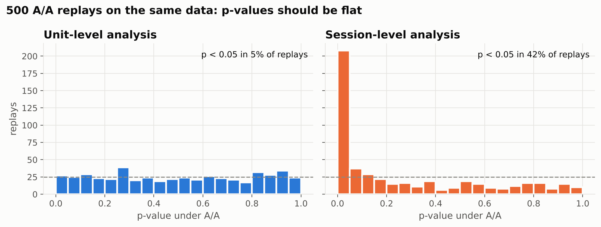

# ab-data-quality

**Is your experiment data fit for inference?** A step-by-step validation pipeline for A/B test data, plus the simulations behind it.

Data can pass every schema check and every business rule and still be useless for comparing variants. Picture purchase events that are perfectly well-formed but get dropped slightly more often in one variant. Every row is valid, and the comparison is broken. This repo checks the property that actually matters: whether the assignment → exposure → outcome chain still supports a causal comparison.

It is the companion code to the post *How to validate your randomization (and your A/B platform)* on [tymerrit.github.io/blog](https://tymerrit.github.io/blog/), and level 1 of the [experimentation hierarchy of needs](https://tymerrit.github.io/blog/experimentation-hierarchy-of-needs/).

## Quick start

```bash
git clone https://github.com/tymerrit/ab-data-quality.git
cd ab-data-quality
pip install -r requirements.txt   # numpy, pandas, scipy, matplotlib, pytest
pip install -e . 
```

```python
from abdq import validate_experiment
from abdq.simulate import SimSpec, generate_experiment, inject_exposure_loss

data, config = generate_experiment(SimSpec(n_units=40_000))
data = inject_exposure_loss(data, rate=0.05, variant="treatment", segment=("platform", "ios"))

report = validate_experiment(data, config)
print(report.status)          # ExperimentStatus.UNTRUSTWORTHY
print(report.reasons)         # ['3.4 exposure_rate_by_variant', '3.6 critical_segment[platform]']
print(report.to_markdown())   # full step-by-step report
```

In that example the overall SRM on exposed units passes (p ≈ 0.007, above the 0.001 threshold). The exposure-rate checks catch the loss.

## Inputs

Three event tables (pandas DataFrames), one per layer of the experiment:

| Table | Required columns | Layer |
|---|---|---|
| `assignments` | `unit_id`, `variant`, `assigned_at` (+ any segment columns, e.g. `platform`) | who was put in which variant |
| `exposures` | `unit_id`, `variant`, `exposed_at` | who actually saw the variant |
| `outcomes` | `event_id`, `unit_id`, `event_time`, `processing_time`, `value` | what they did |

`unit_id` is always the randomization unit. Optional inputs unlock more checks:

| Optional input | Unlocks |
|---|---|
| `covariates`: `unit_id` + numeric pre-period columns | step 6, covariate balance |
| `identities`: `unit_id`, `device_id` | step 5, identity checks |
| `reference_counts`: `{variant: count}` of outcome events from an independent source of truth (e.g. the orders DB) | step 4.4, telling *lost* from *late* |

The `ExperimentConfig` holds the design: expected split, control, analysis window, `as_of`, the maximum expected pipeline lag, and which segment columns are critical.

## The pipeline

| Step | Checks | Kind |
|---|---|---|
| **0. Platform** (`abdq.platform`, run once and after changes) | hash uniformity, determinism, independence across experiments; A/A replay with FPR band + KS uniformity | confirmatory |
| **1. Contracts** | null keys, duplicates, unknown variants, timestamp order | mostly confirmatory |
| **2. Assignment** | SRM (fixed or anytime-valid), units in more than one variant, assignment window | confirmatory |
| **3. Exposure** | orphan exposures, variant mismatch, exposure before assignment, exposure rate by variant, SRM on exposed, exposure rate within critical segments | confirmatory |
| **4. Outcomes** | orphan outcomes, maturity, lag asymmetry, completeness vs reference | confirmatory (lag asymmetry: diagnostic) |
| **5. Identity** | ids per unit by variant, ids shared across variants | confirmatory |
| **6. Balance** | pre-period covariates, Welch t-test + SMD, Bonferroni | confirmatory |
| **7. Diagnostics** | SRM and exposure rate within every segment level | diagnostic only |
| **8. Decision** | `trustworthy` / `preliminary` / `untrustworthy` + reasons | |

Two design rules:

- **Confirmatory vs diagnostic.** Only confirmatory checks change the status. Segment-level SRM is diagnostic: it localizes a problem you already know about. With 50 segments, a few will cross any threshold by chance, and letting each of them block a result would be automated p-hacking in reverse.
- **Preliminary vs untrustworthy.** "The data isn't complete yet" and "the data will never be complete" call for opposite responses: wait, or block. Without an independent source of truth, permanent loss in one variant is indistinguishable from a treatment effect, which is why the loss check needs `reference_counts`.

## What the simulations show

### (a) Selective exposure loss: SRM is a race you can lose

`experiments/sim_exposure_loss.py`. In treatment, 1% of exposures are never logged and the analysis runs on logged units. There is no true effect.



With `m` units per arm, the SRM z-score is about `L·sqrt(m/2)` and the bias z-score of the A/B test is about `d·L·sqrt(m/2)`, where `d` is how far the lost units sit from the average, in standard deviations. Both grow like `sqrt(m)`, so **sample size doesn't decide who notices first; `d` does.** Once `|d| > 1.96 / 3.29 ≈ 0.6`, a fake effect is more likely than not before the SRM check is more likely than not to fire. If the loss hits the top 2% of spenders (`d ≈ 4.8`), the test shows a significant fake effect in 96% of runs at 10k users per arm, while SRM catches it in 1%.

The practical answer is to check the layers directly (exposure rate by variant, within critical segments), and where possible analyze by assignment rather than by logged exposure.

### (b) Your SRM check is peeking too

`experiments/sim_srm_monitoring.py`. 14-day test, 10,000 users per day, 20,000 simulated tests per rule.



| Rule | False alarms (true 50/50) | Detects 49.5/50.5 | Median day of alarm |
|---|---|---|---|
| chi-square p < 0.05, daily | 21.8% | 98% | 3 |
| chi-square p < 0.001, daily | 0.7% | 73% | 8 |
| chi-square p < 0.001, hourly | 2.0% | 77% | 7 |
| anytime-valid mixture LR, α = 0.001, hourly | 0.0% | 41% | 10 |
| anytime-valid mixture LR, calibrated α, hourly | 0.6% | 74% | 7.6 |
| chi-square p < 0.001, end only | 0.1% | 67% | 14 |

The common default (α = 0.05, checked every morning) raises a false SRM alarm on one test in five. A strict threshold fixes most of it: 14 daily looks at p < 0.001 cannot exceed 1.4% false alarms by a union bound, and in practice give 0.7%.

At the same nominal α = 0.001 the anytime-valid test looks weak, but that comparison is unfair: Ville's inequality is conservative, and the realized false alarm rate is around 0.01%. Calibrating its threshold by simulation to the same realized false alarm rate as daily chi-square (nominal α ≈ 0.019 at 10k users/day) closes the gap: equal false alarms, equal power, slightly earlier detection because it can look hourly. The catch is that the calibrated threshold is only guaranteed for the traffic, horizon and look schedule it was calibrated on. Use the uncalibrated version when you monitor continuously and need a guarantee that holds whenever you look; otherwise, a strict fixed threshold checked daily is simpler and just as good.

### (c) The platform: one A/A test validates nothing

`experiments/platform_checks.py`. 500 A/A replays on the same historical session data:



Aggregating to the randomization unit gives a 5% false positive rate. Treating sessions as independent gives 42%. A single live A/A test would most likely have passed either one. The hashing checks catch two classic bugs that each slip past the other checks: modulo bias (58.5/41.5 split) and a shared salt (two "independent" experiments assign identically).

### (d) Validating the validator

`experiments/validate_the_validator.py`. The pipeline is a decision procedure too, so it has error rates. 200 seeds per scenario, 40,000 units each:

| Scenario | Expected | Share with expected status |
|---|---|---|
| healthy | trustworthy | 99.0% |
| 51/49 split instead of 50/50 | untrustworthy | 79.0% |
| 1% of units in both variants | untrustworthy | 100% |
| 5% of treatment iOS exposures lost | untrustworthy | 86.5% |
| slow pipeline, pulled 6h after window | preliminary | 99.0% |
| 5% of treatment outcomes lost for good | untrustworthy | 100% |
| 10% of treatment users get an extra device id | untrustworthy | 100% |
| heavy users leak into treatment, counts 50/50 | untrustworthy | 100% |

The false block rate on healthy experiments is about 1%, the price of running ~15 confirmatory tests per experiment at strict thresholds. Misses are power limits at this sample size: a 1-point SRM at 40k units has z ≈ 4.

## Reproduce

```bash
python experiments/run_scenarios.py          # one report per scenario -> results/reports/
python experiments/sim_exposure_loss.py      # ~30 s
python experiments/sim_srm_monitoring.py     # ~1 min
python experiments/platform_checks.py        # ~10 s
python experiments/validate_the_validator.py # ~6 min
pytest
```

## Limits

Everything here runs on synthetic data with known defects. The simulations show classes of failure and the trade-offs between checks, not production-calibrated error rates. Thresholds should be calibrated on your own pipeline's history and on past incidents. Interference between units (SUTVA violations) is a design problem, not a data-quality one, and is out of scope.

## References

- Kohavi, R., Tang, D., & Xu, Y. (2020). *Trustworthy Online Controlled Experiments*. Cambridge University Press.
- Fabijan, A., et al. (2019). Diagnosing Sample Ratio Mismatch in Online Controlled Experiments: A Taxonomy and Rules of Thumb for Practitioners. *KDD*.
- Lindon, M., & Malek, A. (2022). Anytime-Valid Inference for Multinomial Count Data. *NeurIPS*.
- Johari, R., Pekelis, L., & Walsh, D. (2017). Always Valid Inference: Continuous Monitoring of A/B Tests. *Operations Research*.
- Armitage, P., McPherson, C. K., & Rowe, B. C. (1969). Repeated significance tests on accumulating data. *JRSS A*.

Builds on my master's thesis (HSE University, 2026) on statistical data quality in A/B testing platforms.

## License

MIT
